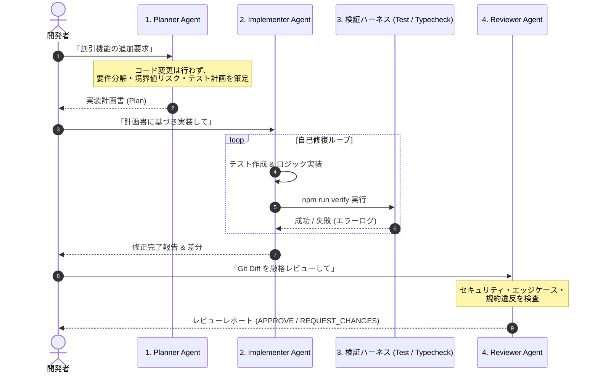

# Curriculum 2: ハーネス＆サブエージェント設計コース（2日間）
<!-- Target: シニアエンジニア、テックリード、ソフトウェアアーキテクト -->
<!-- Time: 2日間（計10〜12時間） -->

本カリキュラムでは、単一プロンプトによる指示の限界を克服し、**パス別インストラクションによるコンテキスト最適化**、**専門特化型サブエージェント（Planner / Implementer / Reviewer）の協調設計**、および **堅牢な検証ハーネス（型検査・Lint・テスト自動実行）** の構築手法を深く学びます。

---

## 🎯 学習ゴール (Learning Objectives)
1. **コンテキスト最適化**: `applyTo` を用いたパス指定型インストラクションにより、トークン消費を抑えつつ専門知識をAIに注入できる。
2. **サブエージェント協調パターンの習得**: 設計専門（Planner）、実装・修正専門（Implementer）、検証・レビュー専門（Reviewer）を分離し、品質の多重防護壁を構築できる。
3. **総合検証ハーネスの構築**: 単なるテストだけでなく、型チェック、リンター、カバレッジ測定を一体化した「失敗を許容しない自己修復ループ」を設計できる。
4. **MCP（Model Context Protocol）と権限制御**: 外部コンテキスト接続（Issue取得、DBスキーマ参照等）時の最小権限設計（Least Privilege）を理解する。

---

## ⏱ タイムスケジュール・アジェンダ

### Day 1: コンテキスト最適化と検証ハーネスの構築 (5〜6時間)
| 時間目安 | モジュール | 内容 |
| :--- | :--- | :--- |
| **00:00 - 01:30** | **Module 1: パス指定型インストラクション設計** | `applyTo` によるコンテキスト分離（フロント・バック・テスト規約） |
| **01:30 - 03:00** | **Module 2: 複合検証ハーネスの実装** | TypeScript型検査 + ESLint + 単体テストの一括ハーネス化 |
| **03:00 - 05:00** | **Module 3: 自己修復限界とエラーハンドリング** | 無限ループ防止、テストアサーション改ざん検知の仕組み |

### Day 2: サブエージェント連携フローと実務適用 (5〜6時間)
| 時間目安 | モジュール | 内容 |
| :--- | :--- | :--- |
| **00:00 - 02:00** | **Module 4: 3大サブエージェントの定義と運用** | `planner.agent.md`, `implementer.agent.md`, `reviewer.agent.md` の役割とプロンプト分離 |
| **02:00 - 03:30** | **Module 5: エージェント間ハンドオフ演習** | 計画策定 → 実装とハーネス通過 → 厳格レビューの実践演習 |
| **03:30 - 04:30** | **Module 6: MCP 連携と最小権限ガバナンス** | ツール呼び出し（Tool Calling）の安全性、読み取り専用アクセスの担保 |
| **04:30 - 05:30** | **Module 7: 総合演習・発表・ディスカッション** | 新機能追加タスクを通じた自律フローの完成度評価 |

---

## 🛠 ハンズオン演習詳細 (Hands-on Steps)

### Step 1: パス指定型インストラクションの作成と挙動確認
1つの指示書にすべての規約を書くと、AIが混乱し指示に従わない「Instruction Drift」が発生します。
1. `.github/instructions/typescript-react.instructions.md` を開き、フロントマターを確認します：
   ```yaml
   ---
   applyTo: "src/**/*.{ts,tsx}"
   ---
   ```
2. `.github/instructions/testing.instructions.md` も同様に `**/*.{test,spec}.ts` に限定されていることを確認します。
3. エディタ上で `src/` 配下のファイルを開いている時と、`tests/` 配下のファイルを開いている時で、Copilot のサジェストや回答傾向が自動的に切り替わることを確認します。

---

### Step 2: 複合検証ハーネス（Verification Harness）の整備
単に `npm test` だけでなく、型安全性（`tsc`）と静的解析（`eslint`）を統合した「完全性検証」をエージェントに課します。

`sandbox-app/package.json` の `scripts` を確認・拡張します：
```json
{
  "scripts": {
    "typecheck": "tsc --noEmit",
    "test": "node --import tsx --test tests/**/*.test.ts",
    "verify": "npm run typecheck && npm test"
  }
}
```
`AGENTS.md` の検証ハーネス記述を `npm run verify` に統一し、エージェントが「型チェック通過」と「テスト通過」の両方を満たすまで完了できないように束縛します。

---

### Step 3: 3大サブエージェント協調ワークフローの体験
`templates/.github/agents/` 配下の3つのエージェント定義を利用し、`sandbox-app` に「割引クーポン適用機能（`applyDiscount`）」を追加する演習を行います。



#### 実践手順:
1. **Planner Agent の呼び出し**:
   - `templates/.github/agents/planner.agent.md` の内容をプロンプトとして適用。
   - 「10%OFFクーポン、ただし上限1000円、負の割引率は例外を投げる仕様」の実装計画書を作成させる。
2. **Implementer Agent の呼び出し**:
   - `templates/.github/agents/implementer.agent.md` を適用。
   - 計画書を渡し、テスト先行で `src/calculator.ts` と `tests/calculator.test.ts` に実装させる。
   - `npm run verify` が自律的にパスすることを確認。
3. **Reviewer Agent の呼び出し**:
   - `templates/.github/agents/reviewer.agent.md` を適用。
   - 「境界値（割引率0%、100%、101%やNaN入力）のハンドリング漏れはないか」を客観的にレビューさせる。

---

### Step 4: MCP（Model Context Protocol）と最小権限アクセス
エージェントに外部ツール（データベース、外部API、GitHub API）を接続する場合のセキュリティ設計を学びます。

- **Read-Only の徹底**:
  本番DBや未承認リポジトリへの書き込み権限（Write/Delete）を剥奪し、Read-Only トークンのみをエージェントに渡す。
- **サンドボックス実行**:
  任意のシェルコマンド実行（`rm -rf`, `curl | bash` 等）を禁止し、ホワイトリスト化されたコマンド（`npm test`, `git diff` 等）のみを実行可能にする。

---

## ✅ 確認チェックリスト (Self-Assessment Checklist)

- [ ] パス別インストラクション（`applyTo`）が機能し、役割に応じたコンテキストが提供されている。
- [ ] 型チェックとテストを一体化した検証ハーネスを構築し、エージェントがそれを自律実行できる。
- [ ] Planner にコード変更をさせず、純粋な設計計画のみを出力させることができた。
- [ ] Implementer がテスト駆動で自己修復ループを回し、全検証を通過できた。
- [ ] Reviewer が見落としがちなエッジケース（0除算、小数の丸め誤差など）を正しく指摘できた。
- [ ] MCP等の外部連携において、最小権限（Least Privilege）の原則が適用されている。
